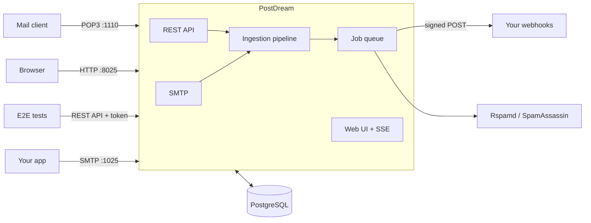

# What is PostDream?

**PostDream is an SMTP sandbox.** Point the SMTP settings of any application (local, QA, staging, CI…) at it and
every email is **intercepted, stored and shown in a web UI**. Nothing is delivered to real recipients unless an admin
explicitly allows it.

> **Why "PostDream"?** In a sandbox, emails are just dreams: they look real, but they are caught before they
> reach the world, like dreams in the dreamcatcher of the logo.

## Why you would use it

| Problem | How PostDream helps |
|---|---|
| A staging environment emails real customers by accident | Every message stops at PostDream. Nothing leaves the sandbox. |
| "Did the welcome email go out? What did it look like?" | A live grid with HTML, text, headers, raw source and attachments of every message. |
| E2E tests need the password-reset link | `GET /api/messages/latest?wait=30s` waits for the email and returns it as JSON. |
| Several teams and environments share one server | Each **inbox** has its own SMTP credentials and API token; members only see their inboxes. |
| "Will this render in Outlook? Is it spam?" | The **Analysis** tab checks HTML/CSS support across email clients, links, DKIM and spam score. |
| Your app must survive SMTP failures | **Chaos testing** makes the SMTP server fail on purpose for one inbox. |
| Something has to react when an email arrives | Signed **webhooks** per inbox, with retries and a delivery log. |

## The parts of PostDream

PostDream is a single Go binary (with the React UI embedded) plus a PostgreSQL database. Inside that binary:

| Part | Port | What it does | Docs |
|---|---|---|---|
| **SMTP server** | `1025` | Receives the emails your apps send. Optional `AUTH` routes each one to an inbox. | [Connect your app](getting-started/connect-your-app.md) |
| **Web UI** | `8025` | Grid, search, message view, analysis, administration. Live updates. | [The mailbox](features/mailbox.md) |
| **REST API** | `8025` | Everything the UI does, plus long-polling for tests and a send API. OpenAPI 3.1. | [REST API](integrations/rest-api.md) |
| **Webhooks** | outbound | Signed `POST` for every email received in an inbox. | [Webhooks](integrations/webhooks.md) |
| **POP3 server** | `1110` | Read an inbox from Thunderbird or Outlook. | [POP3](integrations/pop3.md) |
| **Analysis** | — | Client compatibility, links, deliverability and spam checks. | [Email analysis](features/analysis.md) |
| **Release / relay** | outbound | Opt-in: forward a captured email to a real SMTP server. | [Releasing emails](features/release.md) |
| **Job queue & janitor** | — | Retries webhooks, scores spam, deletes old emails. | [Retention](administration/retention.md) |
| **Metrics** | `8025` or own port | Prometheus metrics and a Grafana dashboard. | [Metrics](operations/metrics.md) |

## Where to go next

- **Try it in five minutes:** [Quick start](getting-started/quick-start.md).
- **Wire it into your project:** [Connect your app](getting-started/connect-your-app.md), then
  [E2E testing](integrations/e2e-testing.md).
- **Run it for a team:** [Inboxes](administration/inboxes.md), [Users and roles](administration/users-and-roles.md)
  and [Deployment](operations/deployment.md).
