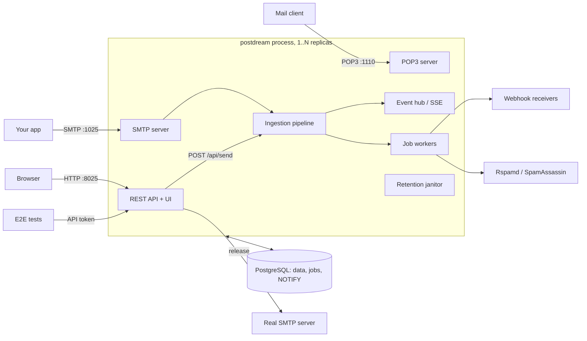
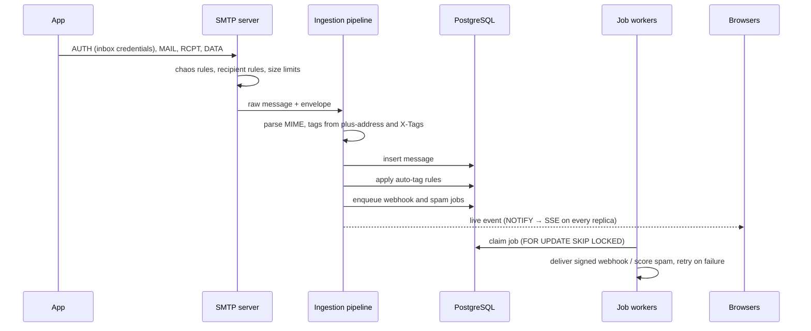

# Architecture

Each Go process runs the SMTP and POP3 servers, the HTTP API (which also serves the React UI embedded in the binary),
the live event stream, the background job workers and the periodic cleanup.

## The life of an email

`POST /api/send` enters the same pipeline, so tags, rules, webhooks and live updates behave identically whichever way
an email arrives.

## Components

| Package | Responsibility |
|---|---|
| `cmd/postdream` | Configuration, migrations, bootstrap (first admin and default inbox), starts every listener |
| `internal/smtpd` | SMTP server (go-smtp), `AUTH PLAIN/LOGIN`, routing by credentials, chaos and recipient rules |
| `internal/ingest` | The single path for new messages |
| `internal/api` | JSON API, auth, SSE, OpenAPI spec, serves the embedded UI |
| `internal/store` | Every SQL query, and the search-syntax parser that turns queries into parameterized SQL |
| `internal/db` | Connection pool and embedded migrations |
| `internal/events` | Live updates, in-process and across replicas |
| `internal/jobs` | Durable job queue with retries and backoff |
| `internal/webhook` | Signed webhook delivery |
| `internal/htmlcheck` | caniemail-based HTML/CSS compatibility |
| `internal/linkcheck` | Link and image checker |
| `internal/deliverability` | DKIM and header checks |
| `internal/spam` | Rspamd and SpamAssassin clients |
| `internal/netguard` | SSRF-safe HTTP client for user-supplied URLs |
| `internal/pop3` | POP3 server |
| `internal/relay` | Release to a real SMTP server |
| `internal/metrics` | Prometheus exposition |
| `internal/mailparse` | Robust MIME parsing |
| `internal/retention` | Periodic cleanup |
| `frontend/` | React 18 + Vite UI, no component library |

## Data

PostgreSQL holds users, sessions, inboxes and their settings, messages (raw source plus parsed fields), tags, rules,
webhooks and their deliveries, the job queue, the link-check cache and the release log. Schema changes are numbered
SQL migrations embedded in the binary.
