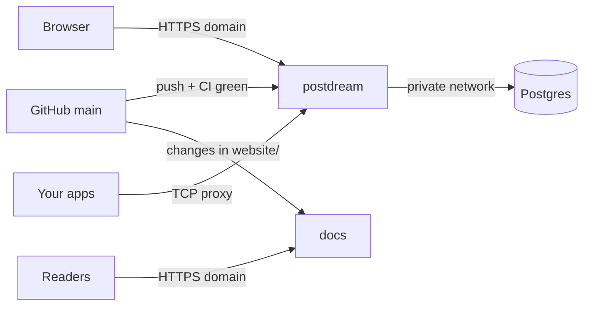

# Deploying on Railway

[Railway](https://railway.com) builds the repository's `Dockerfile`, runs PostgreSQL next to it and redeploys on every
push. This is how the public sandbox and this documentation site are hosted.

## Services

A Railway project with three services:

| Service | Source | Notes |
|---|---|---|
| **Postgres** | Railway's PostgreSQL template | Private network only |
| **postdream** | This repository, branch `main`, root `/` | Builds the root `Dockerfile` |
| **docs** | This repository, branch `main`, root `/website` | Builds `website/Dockerfile`, a static site served by Caddy |



## The postdream service

**Variables**

```bash
DATABASE_URL=${{Postgres.DATABASE_URL}}
PORT=8025                 # the port Railway's domain and health check use
HTTP_ADDR=:8025
SMTP_ADDR=:1025
SMTP_AUTH=required        # the SMTP endpoint is public
COOKIE_SECURE=true        # Railway serves HTTPS
TRUST_PROXY=true          # real client IPs for rate limiting
PUBLIC_URL=https://<your-domain>
ADMIN_EMAIL=admin@example.com
ADMIN_PASSWORD=<only used on the first start>
DEFAULT_INBOX_SMTP_PASSWORD=<optional>
```

**Settings**

- **Networking:** a domain pointing to port `8025` for the UI and API, and a **TCP proxy** to port `1025` for SMTP.
  Railway gives you a host and port such as `something.proxy.rlwy.net:12345`; that is what your apps use as SMTP
  host and port. A service has one TCP proxy, so POP3 is not exposed.
- **Health check:** `/api/health`.
- **Source:** branch `main` with auto-deploy. Turn on **Wait for CI** so a push is only deployed after the GitHub
  Actions checks pass.

> **📝 Note: Shared railway.app domains**
>
> Chrome may flag a brand-new `*.up.railway.app` domain that shows a login page as "Dangerous" (a Safe Browsing
> heuristic for shared hosting domains). A custom domain avoids it.

## The docs service

- **Root directory:** `/website`, so only the documentation is in the build context.
- **Builder:** `website/Dockerfile` (Node builds the static site, Caddy serves it on `$PORT`).
- **Watch paths:** `/website/**`, so changes to the Go code do not redeploy the docs.
- **Variable:** `DOCS_URL=https://<docs-domain>` (used for canonical URLs and the sitemap).
